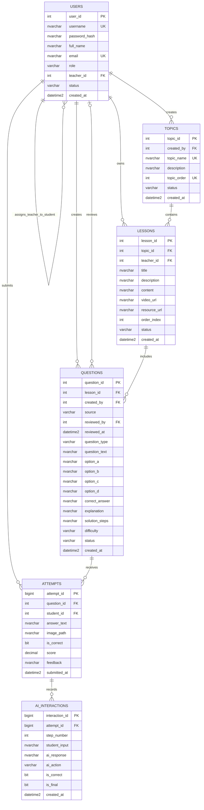

# Math10 AI — Database design

## Entity relationship diagram

`o|` on `QUESTIONS.reviews` means a question may have no reviewer yet. A published AI question must have both `reviewed_by` and `reviewed_at`.

## Normalization notes

- `TOPICS` stores each topic once. Lessons refer to it through `topic_id`; topic names/descriptions are not repeated in each lesson.
- `LESSONS` owns its text, video, and external resource fields. Questions refer to a lesson with `lesson_id` rather than copying lesson details.
- `QUESTIONS` stores a question once. Each submission is a separate `ATTEMPTS` row referencing it.
- Every tutor turn is a separate `AI_INTERACTIONS` row. Turns are not concatenated into a single text field, so they can be ordered and queried by `attempt_id` and `step_number`.
- Teacher assignment uses the nullable self-referencing `USERS.teacher_id`, supporting one responsible teacher per student without a junction table.
- There is no `SUBJECTS` table because this MVP covers one subject: Grade 10 Mathematics. There are exactly six core tables.

## Integrity and application rules

SQL constraints enforce roles/status values, unique usernames/emails, valid topic order, question type and MCQ answer shape, score range, AI draft review before publication, upload-answer presence, and foreign-key relationships. SQL Server `CHECK` constraints cannot verify the role of a row referenced by a foreign key. The Spring service layer must therefore verify that:

- `USERS.teacher_id` references a TEACHER and is assigned only to a STUDENT.
- `LESSONS.teacher_id` is a TEACHER and matches the acting teacher for edits.
- `QUESTIONS.created_by` and `reviewed_by` are authorized staff roles.
- `ATTEMPTS.student_id` is a STUDENT; students can read only their own attempts.
- A teacher can read progress only for students assigned to that teacher.

## Script order

1. Run [`schema.sql`](schema.sql) in SQL Server to create the database and six tables.
2. The current seed follows **Toán 10 – Kết nối tri thức với cuộc sống**, Tập 1 and Tập 2. It inserts nine chapter topics and 27 lessons with concise original notes. Review and expand these lessons and question coverage before using them as official course materials. See [`docs/curriculum.md`](../docs/curriculum.md).

Sample accounts are inactive and use a password-hash placeholder; the application must generate a real BCrypt hash before any login demo. AI credentials belong in server-side environment/secret configuration, not in these tables or seed scripts.
