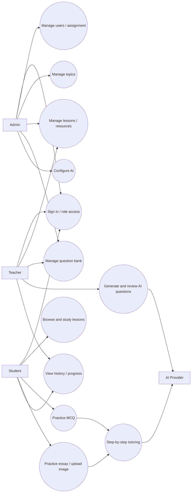
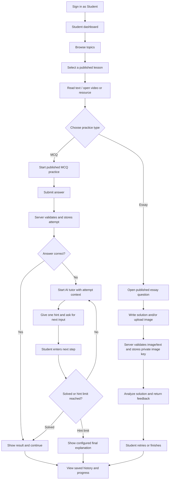
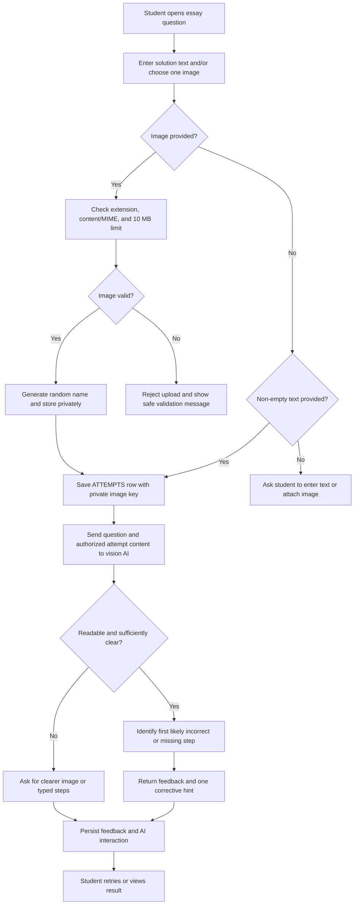
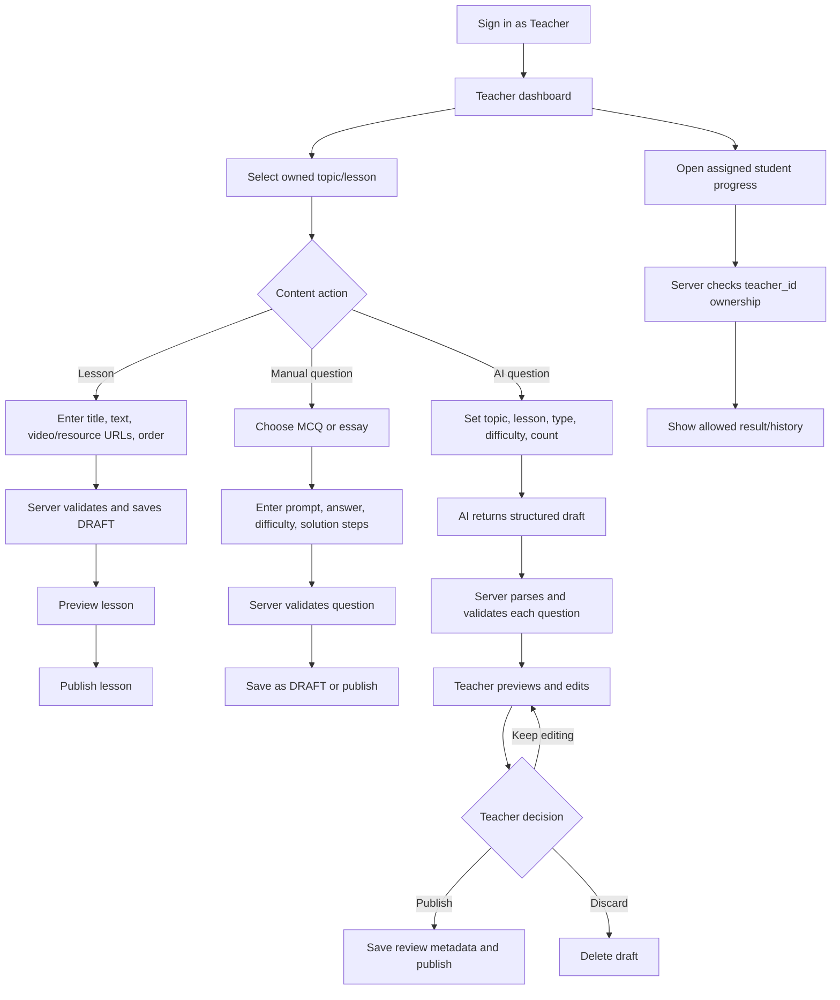
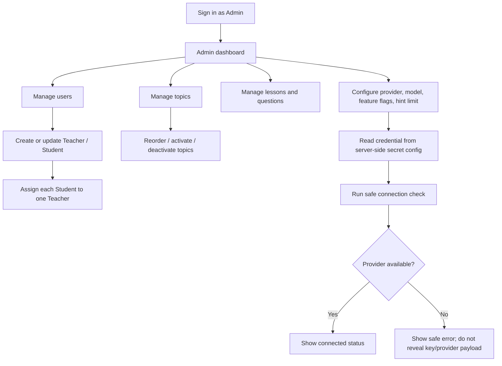

# Math10 AI — Business flows

These flows describe the intended server behavior. The current frontend is still a visual prototype; buttons do not yet call these backend operations.

## 1. Use case overview



## 2. Student learning flow



## 3. MCQ tutoring state flow

```mermaid
stateDiagram-v2
    [*] --> Answering
    Answering --> Correct: correct option submitted
    Answering --> NeedsHint: incorrect option submitted
    NeedsHint --> WaitingForStudent: persist HINT / ASK_INPUT
    WaitingForStudent --> EvaluatingStep: student sends next calculation
    EvaluatingStep --> Continue: step is valid
    EvaluatingStep --> NeedsHint: step is still incorrect
    Continue --> WaitingForStudent: more solution steps remain
    Continue --> Correct: trusted solution completed
    NeedsHint --> FinalExplanation: configured hint limit reached
    Correct --> Saved: persist score and tutor history
    FinalExplanation --> Saved: persist final tutor turn
    Answering --> SafeError: AI unavailable / response invalid
    WaitingForStudent --> SafeError: AI unavailable / response invalid
    SafeError --> Saved: preserve attempt; offer retry
    Saved --> [*]
```



The backend keeps the trusted correct answer and reference steps in server context. The student sees only the current hint or requested next step until the final-solution condition is reached. Every AI response includes a structured action (`HINT`, `ASK_INPUT`, `CONFIRM`, `ERROR`, `FINAL_SOLUTION`, or `CLARIFICATION`) and is saved as an `AI_INTERACTIONS` row.

## 4. Essay submission and feedback flow



The image is not exposed through a public static URL. Each retrieval checks that the requester is the student who owns the attempt, the student's assigned teacher, or an Admin.

## 5. Teacher content and question flow



## 6. Admin flow



## 7. AI question generator flow

```mermaid
sequenceDiagram
    actor T as Teacher
    participant UI as Web UI
    participant S as Spring Service
    participant AI as AI Provider
    participant DB as SQL Server
    T->>UI: Select topic, lesson, type, difficulty, count
    UI->>S: Submit generation request
    S->>S: Check role, ownership, inputs, and limits
    S->>AI: Send prompt and structured generation request
    AI-->>S: Return structured draft response
    S->>S: Parse JSON and validate options/answer/steps
    S->>DB: Save valid drafts with source=AI and PENDING_REVIEW
    DB-->>S: Return draft IDs
    S-->>UI: Show previewable drafts
    T->>UI: Edit, delete, or approve each question
    UI->>S: Submit review decision
    S->>S: Recheck teacher role and lesson ownership
    S->>DB: Save review metadata; publish only approved questions
    S-->>UI: Show saved status
```

## 8. Frontend pages mapped to flows

| Role | Current prototype pages | Backend operations to connect later |
|---|---|---|
| Student | Dashboard, lesson list/detail, MCQ, essay upload, history, progress | Authenticated reads; published lesson/question queries; attempt and interaction writes; private image upload/retrieval. |
| Teacher | Dashboard, students, lessons, question bank, AI generator, progress | Owned lesson CRUD; assigned-student queries; manual/AI question draft review; progress queries. |
| Admin | Dashboard, users, topics, questions, AI settings | User/assignment/topic CRUD; system content moderation; safe provider configuration. |
